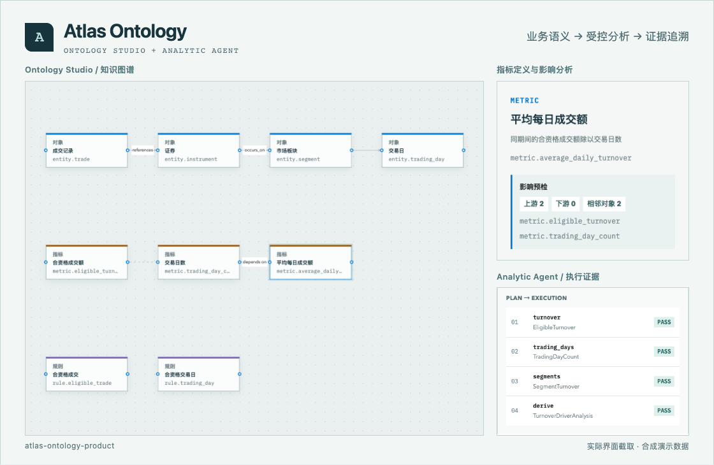

  

<h1 align="center">FlyingDoggy</h1>

<b>一个尝试在做一人公司的咨询顾问，样样通样样松。</b>

写方案，也写代码，顺手把能用的小工具做出来。 
在咨询、产品和技术之间来回折腾。

  <a href="#projects">做过的东西</a> &nbsp;·&nbsp;
  <a href="#activity">代码足迹</a> &nbsp;·&nbsp;
  <a href="#now">最近在忙啥</a> &nbsp;·&nbsp;
  <a href="https://github.com/FlyingDoggy?tab=repositories">所有仓库 ↗</a>

 

<h2>做过的东西</h2>

<b>个人财务助手</b> · 本地优先的账单、预算与分析工具。 
<a href="https://github.com/FlyingDoggy/personal-finance-assistant">查看源码 ↗</a>

 

<b>Atlas Ontology</b> · 把业务语义、版本治理和可追溯分析连起来。 
<a href="https://github.com/FlyingDoggy/atlas-ontology-product">查看源码 ↗</a>

 

<b>企业智能体验 EIX 2.0</b> · 企业 AI 的设计白皮书、设计系统与可交互参考。 
<a href="https://github.com/FlyingDoggy/enterprise-intelligence-experience">查看源码 ↗</a>

其他小工具：
<a href="https://github.com/FlyingDoggy/frontend-slides-editable">Frontend Slides Editable</a> ·
<a href="https://github.com/FlyingDoggy/sprout-codex/tree/codex/sprout-port/mods/sprout-codex">小苗 · Codex</a>

<h2>代码足迹</h2>

写一点代码，留一点足迹，再让吃豆人来收尾。

<picture>
  <source media="(prefers-color-scheme: dark)" srcset="./assets/pacman-dark.svg">
  
</picture>

<h3>GitHub Metrics</h3>

  <picture>
    <source media="(prefers-color-scheme: dark)" srcset="./assets/metrics-overview-dark.svg">
    
  </picture>
  <picture>
    <source media="(prefers-color-scheme: dark)" srcset="./assets/metrics-languages-dark.svg">
    
  </picture>

由 <a href="https://github.com/abozanona/pacman-contribution-graph">Pac-Man Contribution Graph</a> 与 <a href="https://github.com/lowlighter/metrics">Metrics</a> 生成 · 语言占比按仓库代码量统计

<h2>最近在忙啥</h2>

在武汉坐牢。

 

<samp>先做出来，再慢慢打磨。</samp>

